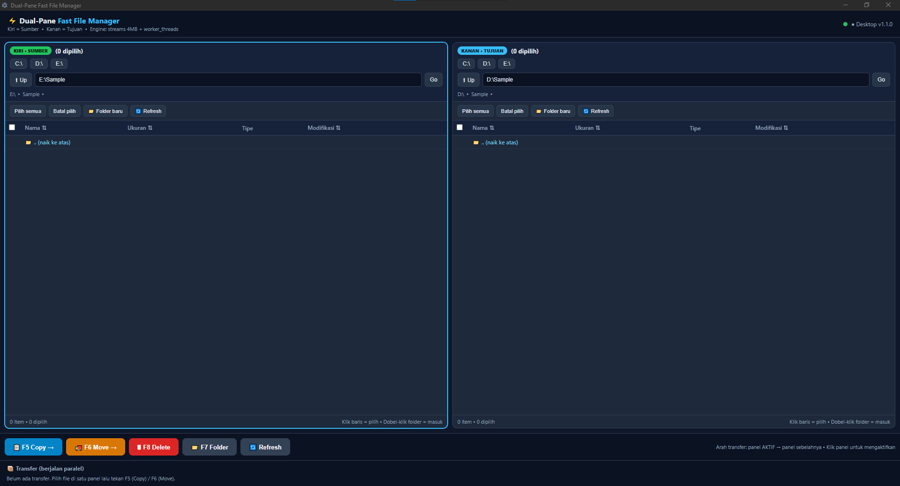

# ⚡ Dual-Pane Fast File Manager


File manager desktop **dual-pane** (kiri = sumber, kanan = tujuan) yang dirancang untuk
**menyalin/memindahkan data bervolume besar secepat batas hardware disk** — tanpa UI freeze,
tanpa RAM jebol, dengan progres real-time (kecepatan, ETA, file berjalan).

Dibangun di atas **Node.js + Electron**, tanpa framework frontend berat dan tanpa
dependensi runtime (seluruh logika memakai modul bawaan Node).



> Spesifikasi produk lengkap: [`_DEV/prd.md`](_DEV/prd.md).
> Catatan rilis: [`_DEV/Rilis-V1.0.0.md`](_DEV/Rilis-V1.0.0.md).

---

## ✨ Fitur

| Kategori | Isi |
|---|---|
| 🖥️ Dual-pane independen | Navigasi kiri/kanan terpisah, address bar + breadcrumbs, tabel Nama/Ukuran/Tipe/Modifikasi, sortir kolom, pintasan drive (C:, D:, USB) |
| ⌨️ Aksi cepat | `F5` Copy → panel sebelah, `F6` Move, `F8` Delete, `F7` Folder baru, klik panel untuk mengaktifkan sumber |
| 🚀 Engine transfer cepat | Stream 4 MB (`highWaterMark`), `worker_threads` agar UI tidak freeze, IPC throttling |
| 🧠 Smart transfer | File `>100 MB` sekuensial ( $1 $1 throughput), file `<5 MB` konkuren 12, sisanya pool 4 |
| 🔀 Paralel antar job | Banyak transfer jalan bersamaan; file besar (>100 MB) gantian 1-per-1 lintas job via slot global anti-thrashing |
| 📁 Urutan per folder | File lepas dikerjakan dulu, lalu tiap folder diselesaikan satu-per-satu sampai tuntas |
| ⏸️ Kontrol penuh | Pause, Resume, Cancel (paksa terminate + bersih file parsial), auto-refresh kedua panel saat job selesai |
| ⚠️ Conflict handling | Timpa / Lewati / Rename, antre satu-per-satu, plus opsi "berlaku untuk semua" |
| ↻ Tahan putus-sambung | Coba-otomatis 3x per file (backoff), pesan error ramah ("drive terputus?"), tombol **Coba lagi** untuk job gagal/batal |
| 🛡️ Anti-stuck | Watchdog 120 dtk tanpa progres, worker crash langsung menggagalkan file (bukan menggantung job) |

---

## 🚀 Cara pakai (pengguna Windows)

**Tanpa install apa pun selain hasil build:**

1. Unduh dari halaman [Releases](../../releases) (atau build sendiri, lihat bawah):
   - `Fast File Manager Setup 1.0.0.exe` — installer (Start Menu/Desktop shortcut + uninstaller), atau
   - `FastFileManager-Portable.exe` — langsung double-klik, bisa dibawa di flashdisk.
2. Pilih file/folder di satu panel → tekan `F5` (Copy) / `F6` (Move) → file mendarat di panel sebelah.

**Dari source (mode developer):** double-klik `Jalankan-FileManager.bat`
(menjalankan aplikasi desktop Electron; pertama kali menginstall runtime otomatis).

---

## 🛠️ Instalasi & pengembangan

Syarat: **Node.js ≥ 18** (https://nodejs.org/) dan Git.

```bat
git clone https://github.com/<akun-anda>/dual-pane-fast-file-manager.git
cd dual-pane-fast-file-manager
npm install
npm start          :: aplikasi desktop (Electron)
npm run browser    :: mode browser saja (http://localhost:4821)
```

Port bisa diubah lewat environment: `set PORT=8080 && npm start`.

### 📦 Build EXE

```bat
Build-Exe.bat      :: atau: npm run dist
```

Hasil di folder `dist\`: installer NSIS + portable EXE (±106 MB, mayoritas runtime Electron).
Ikon aplikasi belum dipasang — taruh `icon.ico` (256×256) di root dan daftarkan di
`package.json` → `build.win.icon` bila ingin mengganti ikon default Electron.

---

## 🗂️ Struktur proyek

```
.
├── main.js               # Electron Main Process (jendela desktop + start backend)
├── preload.js            # Jembatan aman UI <-> desktop (contextBridge)
├── server.js             # Backend: HTTP API + Job/Queue Engine + smart transfer
├── transfer-worker.js    # Worker thread: copy 1 file via stream 4 MB + progres
├── public/
│   └── index.html        # Seluruh UI dual-pane (vanilla HTML/CSS/JS, tanpa build)
├── _DEV/
│   ├── prd.md            # Product Requirements Document (spesifikasi produk)
│   └── Rilis-V1.0.0.md   # Catatan rilis v1.0.0 (artefak, hash, panduan publish)
├── _image/
│   └── V1.0.0.png        # Screenshot UI v1.0.0 (dipakai README + catatan rilis)
├── Jalankan-FileManager.bat  # Launcer desktop (double-klik)
├── Build-Exe.bat             # Deploy -> installer + portable EXE
└── dist/                 # Hasil build (diabaikan git)
```

**Tanpa dependensi runtime.** Satu-satunya devDependency adalah `electron` dan
`electron-builder`. Tidak ada React/Vue/bundler — UI adalah satu file HTML yang
dilayani backend (dengan header `no-store` agar Electron selalu memuat versi terbaru).

---

## ⚙️ Cara kerja engine (ringkas)

```
UI (panel) --HTTP--> server.js (Job Manager) --worker_threads--> transfer-worker.js
                              |                                         |
                     antrean konflik,                        fs stream 4 MB/chunk
                     slot file besar,                        + watchdog + pause/
                     retry 3x, watchdog                      resume/cancel
```

- **RAM stabil**: file dipindah per-chunk via `stream.pipeline`, bukan dimuat utuh.
- **UI responsif**: semua I/O berat di worker thread; progres dikirim hanya saat % berubah (atau >200 ms).
- **Urutan**: file lepas → tiap folder tuntas → besar sekuensial → kecil konkuren.
- **Batal selalu lepas**: pesan cancel → kuras antrean konflik → terminate paksa 3 dtk.

API (untuk kontributor): `GET /api/drives`, `GET /api/list?path=`,
`POST /api/mkdir|rename|delete|transfer`, `GET /api/jobs`,
`GET|POST /api/jobs/:id[/pause|resume|cancel|resolve|retry]`.

Konstanta tuning di `server.js`: `LARGE_FILE` (100 MB), `SMALL_FILE` (5 MB),
`CONCURRENCY_SMALL` (12), `CONCURRENCY_MEDIUM` (4), `STALL_TIMEOUT_MS` (120 dtk).

---

## 🗺️ Roadmap

- [x] Fase 1 — UI dual-pane + navigasi (MVP)
- [x] Fase 2 — Worker engine copy/move rekursif
- [x] Fase 3 — Queue, progres, konflik, pause/resume/cancel
- [x] Fase 4 — Build EXE (installer + portable)
- [ ] Verifikasi checksum otomatis pasca-copy
- [ ] Mode sinkronisasi folder (mirror)
- [ ] Riwayat transfer persisten (SQLite)
- [ ] Ikon + code signing resmi
- [ ] Dukungan Linux/macOS

Lihat detail fase di [`_DEV/prd.md`](_DEV/prd.md) seksi 7.

---

## 🤝 Berkontribusi

1. Fork repo ini.
2. Buat branch: `git checkout -b fitur/nama-fitur`.
3. Pastikan `node --check server.js main.js` lolos dan uji manual skenario utama
   (copy/move folder besar, konflik, batal, retry).
4. Commit dengan pesan jelas (Indonesia/Inggris bebas) lalu buka Pull Request.

Bug / ide fitur: buka [Issues](../../issues) dengan langkah reproduksi + contoh log.

---

## 📄 Lisensi

MIT — lihat [`LICENSE`](LICENSE). Bebas pakai, ubah, dan distribusikan.
